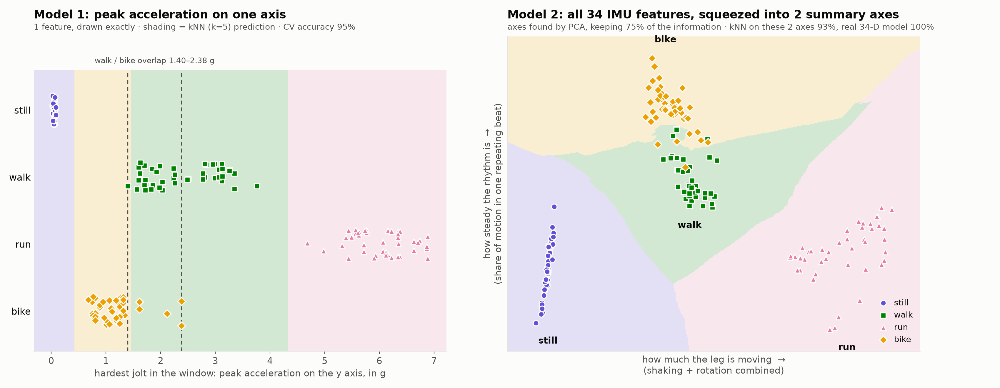
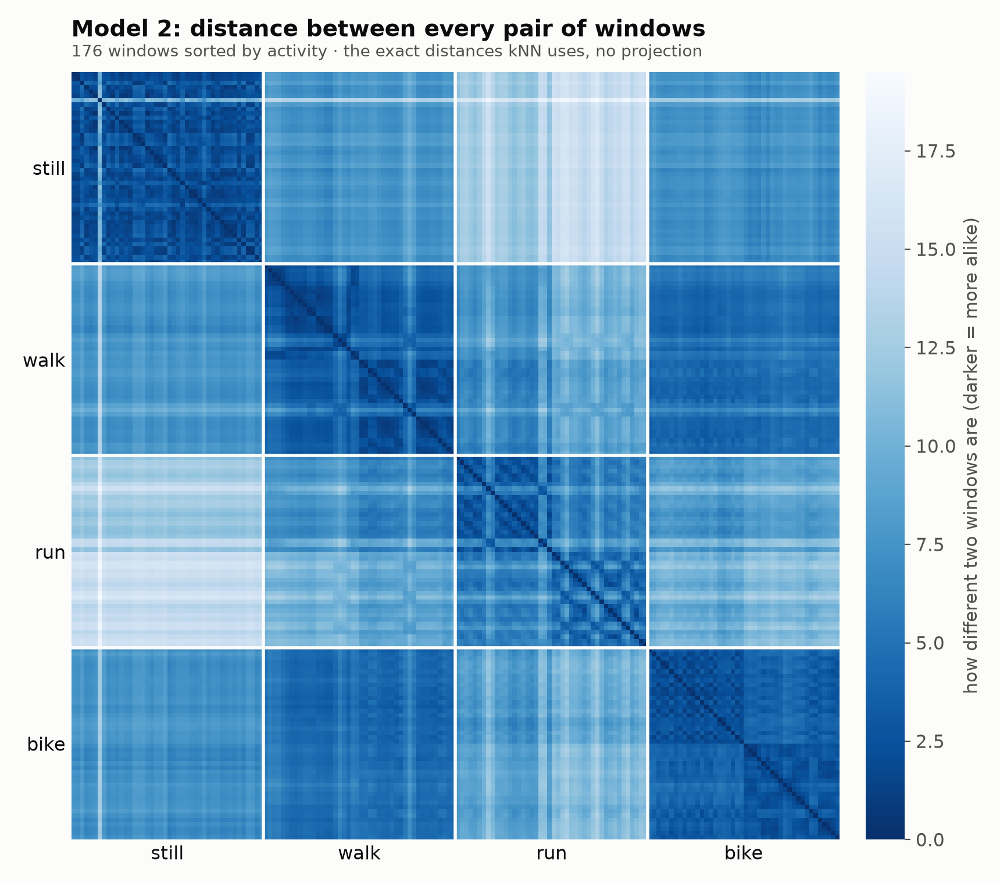
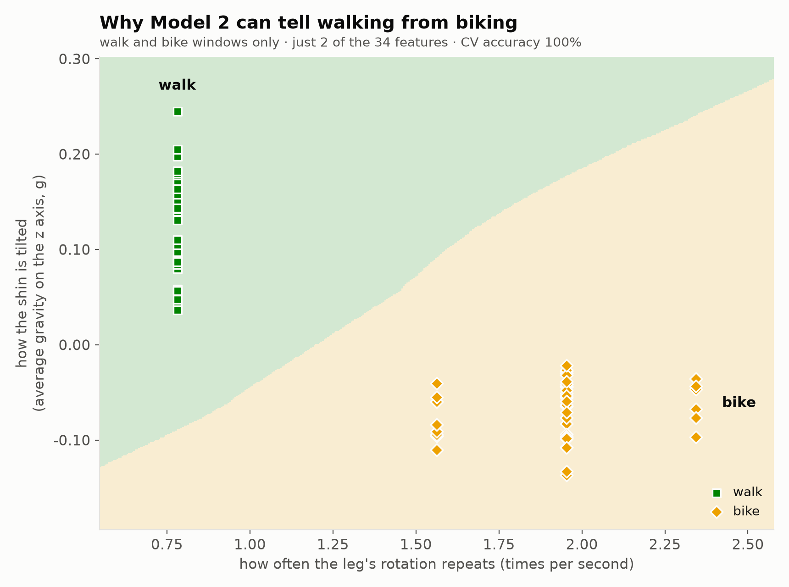

# How the Gait Classifier Works

This wearable tells apart four activities: **standing still, walking, running,
and biking**. It uses an Arduino UNO Q and an MPU-6050 motion sensor strapped
to the ankle. Two k-nearest-neighbour (kNN) models do the classifying, and
neither one is a neural net:

- **Model 1** looks only at the peak acceleration along one axis.
- **Model 2** uses every output of the IMU.

**Result:** Model 2 is better on every test we ran. On a session it had never
seen, Model 2 was **97%** accurate and Model 1 was **90%**. The rest of this
document explains how the system works and why Model 2 wins.

---

## 1. The pipeline at a glance

```
MPU-6050 ──I2C──▶ STM32 microcontroller ──Bridge──▶ Linux side (Python) ──▶ web page
 6 numbers         reads the sensor at              cuts the data into        live gait,
 per sample        exactly 50 Hz                    2.56 s windows, turns     recording,
                                                    each into features,       accuracy
                                                    and classifies with kNN
```

The UNO Q has two processors. The **microcontroller** (`sketch/sketch.ino`)
handles the timing-critical work: it reads the sensor at a steady rate. The
**Linux side** (`python/main.py` and `python/gait_model.py`) stores the
data, trains the models, classifies, and hosts the web page on port 7000.

## 2. Reading the sensor

Every 20 ms (**50 Hz**), the microcontroller reads six numbers from the
MPU-6050:

| Channel    | Meaning                          | Unit |
|------------|----------------------------------|------|
| ax, ay, az | acceleration along x, y, z       | g    |
| gx, gy, gz | rotation speed around x, y, z    | °/s  |

With our placement the **x axis runs along the shin**: it reads about 1 g
(gravity) when you stand still. The y and z axes run across the leg.

**Why 50 Hz?** Human movement is slow. Steps and pedal strokes repeat about 1–3
times a second, and even the sharp jolt of a foot strike sits below about 20 Hz.
50 Hz captures all of that with margin, and is a standard rate in activity
recognition research. The sensor's built-in low-pass filter is set to about
21 Hz, so faster vibrations can't masquerade as slower ones (aliasing).

**Sensor ranges:** ±16 g and ±2000 °/s. At the ankle, running can produce
impacts of more than 6 g (we measured up to 6.9 g). A smaller range would clip
those peaks.

## 3. Collecting training data

On the web page you choose an activity, a length (30 s by default), and a
countdown (5 s, so you can put the phone away). Then you do the activity until
the progress bar fills. The app records exactly `seconds × 50` samples and
saves them as a CSV file:

```
data/<activity>/<activity>_<date>-<time>.csv      e.g. data/walk/walk_20261026-230308.csv
```

### Does a new training run overwrite the old one?

**No.** Each recording gets its own file with a timestamp in the name, so
nothing is ever overwritten. Every time a recording finishes (or one is
deleted), the models are **rebuilt from all of the recordings** on the board.
Adding a second "walk" recording therefore adds to the walking examples; it
doesn't replace the first one. To get rid of a bad recording, delete it on the
web page. Redeploying the app doesn't touch the `data/` folder either.

## 4. Windows: turning a stream into examples

A single sample can't tell you whether someone is walking, but a couple of
seconds of motion can. The data is cut into **windows of 128 samples
(2.56 s)**, which is long enough to hold at least two full strides or pedal
turns.

- **For training,** each 30 s recording is cut into windows that overlap by
  half (a new window every 1.28 s). That gives **22 windows per recording**.
- **For live use,** a new window is classified every 0.5 s, using the most
  recent 2.56 s of data.

Each window is reduced to a short list of numbers called **features**. The two
models differ only in which features they use.

## 5. The features

### Model 1: peak acceleration in one direction (1 feature)

For one axis, take the largest absolute acceleration in the window:

```
feature = max |a_axis|    over the 128 samples
```

The app tries the x, y, and z axes and keeps the one that cross-validates best
(you can also force an axis on the web page). With the current data the
**y axis** won (x 80%, y 95%, z 88%). The y axis runs across the shin, so
gravity barely shows up on it and its peak is almost purely movement. Standing
still reads about 0.05 g on it.

### Model 2: all IMU outputs (34 features)

| Features | What they capture |
|---|---|
| mean of each of the 6 channels | **orientation**: which way gravity points, i.e. how the leg is angled |
| standard deviation of each channel | **intensity**: how hard each axis is shaking or rotating |
| min and max of each channel | **extremes**: impact peaks and fastest swings |
| mean, std, and max of total acceleration \|a\| and total rotation \|ω\| | overall movement energy, regardless of orientation |
| dominant frequency of \|a\| and of \|ω\|, plus how strong it is | **rhythm**: step rate or pedalling cadence (from an FFT) |

These features weren't searched for or tuned using our data. They come from
standard activity-recognition practice, chosen by thinking about what
physically differs between the four activities.

## 6. How kNN classifies

kNN doesn't learn equations. It **memorises** every training window as a point
in feature space, and classifies a new window by asking which training windows
it is closest to.

1. **Scale the features.** Each feature is converted to a z-score (subtract its
   mean, divide by its standard deviation, both measured on the training data).
   Without this step a feature measured in hundreds of °/s would swamp one
   measured in g, simply because its numbers are bigger.
2. **Measure distances.** Compute the straight-line (Euclidean) distance from
   the new window to every training window:
   `distance = √( (z1ₐ − z1ᵦ)² + (z2ₐ − z2ᵦ)² + … )`.
3. **Vote.** Take the **k = 5 closest** training windows. The activity with the
   most votes wins. The web page shows the vote shares, e.g. "walk 80%, bike 20%".
4. **Smooth.** The live display averages the votes over the last 3 windows
   (about 1.5 s), so a single odd window doesn't make the label flicker.

For Model 1 the "feature space" is a single number line: a new window is
labelled by whichever activities had similar peak accelerations. For Model 2
it's a 34-dimensional space, where two windows count as close only if they
match in orientation, intensity, extremes, *and* rhythm.

## 7. How accuracy is measured

Testing a model on the windows it was trained on would score close to 100%
for kNN every time, which would prove nothing. We used two tests:

- **Blocked 5-fold cross-validation (shown live on the web page).** Each
  recording is split into 5 consecutive time blocks. Each block takes a turn
  as the test set and is classified by a model trained on the other 4 blocks
  of every recording. The blocks are consecutive in time rather than shuffled,
  because neighbouring windows overlap and look almost identical, so
  shuffling would leak test data into training.
- **Leave-one-session-out (the stricter test).** We recorded every activity
  twice, in two separate sessions. Each session is classified by a model
  trained only on the *other* session. This is closer to real use: the model
  has never seen that walk or that bike ride.

## 8. Results

Training data: two 30 s recordings per activity in two sessions, with the
sensor on the ankle (44 windows per activity, 176 in total).

| Test | Model 1 (peak y accel) | Model 2 (all IMU) |
|---|---|---|
| Blocked 5-fold | 95.5% (168/176) | **100%** (176/176) |
| Train on one session, test on the other | 90.3% (159/176) | **96.6%** (170/176) |

**Confusion matrices** (rows = true activity, columns = predicted), from the
stricter session test:

Model 1:

| true \ pred | still | walk | run | bike |
|---|---|---|---|---|
| still | **44** | 0 | 0 | 0 |
| walk  | 0 | **30** | 1 | 13 |
| run   | 0 | 0 | **44** | 0 |
| bike  | 0 | 3 | 0 | **41** |

Model 2:

| true \ pred | still | walk | run | bike |
|---|---|---|---|---|
| still | **44** | 0 | 0 | 0 |
| walk  | 0 | **43** | 0 | 1 |
| run   | 0 | 4 | **40** | 0 |
| bike  | 0 | 1 | 0 | **43** |

## 9. Which model is better, and why

**Model 2 is better.** It never scored lower than Model 1, and on the
stricter test it made 6 mistakes against Model 1's 17. The reason is
visible in Model 1's single feature:

| Activity | Peak \|a_y\| per window (g) |
|---|---|
| still | 0.02 – 0.09 |
| bike  | 0.68 – 2.38 |
| walk  | 1.40 – 3.76 |
| run   | 4.68 – 6.88 |

**Still** and **run** sit far from everything else, so one number separates
them easily. **Walking and biking overlap** between 1.40 and 2.38 g. Every one
of Model 1's blocked-CV errors is a walk/bike mix-up. Peak acceleration
measures *how hard* the leg moves, and gentle walking and pedalling are about
equally hard at the ankle.

The session test shows the problem clearly. Our first walk was gentle (peaks
1.40–2.26 g, median 1.85) and our second was brisk (median 3.03 g). When
Model 1 learned "walking" only from the brisk session, the gentle walk
looked more like biking, and **13 of its 44 walking windows were called
bike**. One number can't tell a slow walk from a bike ride.

**Walking and biking differ in *how* the leg moves**, and only Model 2 can
see that. The features that separate them best in our data are:

1. **Rhythm of rotation.** The dominant frequency of |ω| is 0.78 Hz when
   walking (once per stride, when the leg swings) and about 1.9 Hz when
   biking (the ankle goes around continuously with each pedal turn). This was
   the strongest separator by a wide margin, and it held in both sessions.
2. **Shin tilt.** The average gravity on the z axis is +0.12 g when walking
   and −0.07 g when biking, because the shin is angled differently on a bike.
   Orientation also matters for the "air-biking on your back" case, where
   gravity points along a completely different axis.
3. **How steady the rhythm is.** Pedalling puts 44% of the motion into one
   repeating beat, against 26% for walking.

Two further checks support this explanation:

- With the 6 orientation (mean) features **removed**, Model 2 still scores
  100% on blocked CV. Movement alone (intensity, extremes, rhythm) is enough.
- With **only** the 6 orientation features, it scores 97%, so leg angle by
  itself already carries a lot of the information.

Model 2 isn't perfect either. In the session test it called **4 windows from
our first, gentler run "walk"**. That run was less intense (average rotation
283 °/s, against 330 °/s in the second run), and the brisk second walk was
the closest thing it had seen. More recordings at a range of speeds would fix
this.

In short, Model 2 has several independent ways to tell activities apart.
When one of them is ambiguous for a window, the others still separate it.
Model 1 has just one, and that one can't separate a gentle walk from biking.

Changing **k** barely matters: for Model 1, k = 1/3/5/9 gave
98/95/95.5/97% (blocked CV), and Model 2 stayed at 100% for all of them. The
bottleneck is what Model 1 measures, not how it votes.

## 10. Pictures of the models

A 34-dimensional model can't be drawn directly, so the figures in
`analysis/figures/` use four different views. Each one shades the background by
what kNN would predict there.

**Model 1 vs. Model 2.** Left: Model 1 drawn exactly, since it only has one
feature. The dashed lines mark the walk/bike overlap. Right: Model 2's 34
features squeezed into 2 summary axes with PCA (principal component analysis).
Those axes turn out to mean "how much the leg is moving" (across) and "how
steady the rhythm is" (up). The flattened picture keeps 75% of the information,
and a kNN run on just these 2 axes scores 93% (the real model scores 100%), so
the picture is close to what the model sees but not exact.



**Every pairwise distance (no flattening).** Each cell is the actual 34-D
distance between two windows, sorted by activity. The dark blocks on the
diagonal show that windows of the same activity are close to each other,
which is exactly what kNN relies on.



**Why walking and biking separate.** This uses just two of Model 2's features:
how often the leg's rotation repeats, and how the shin is tilted. These two
alone separate walking from biking 100%.



To regenerate the figures after recording more data, run
`python3 gait-classifier/analysis/plot_knn.py --fetch` (needs numpy and
matplotlib on your computer).

## 11. Limitations and caveats

- **Small dataset.** There are two recordings per activity, from one person,
  on one evening. The session test is the more honest number, but a new
  person, new shoes, or a different bike would probably lower it further.
- **Speed range.** The mistakes come from activities done at a different
  intensity than in training (a gentle walk, a gentle run). Recording each
  activity at slow, normal, and fast speeds would help both models,
  especially Model 1.
- **No air-biking recording yet.** The orientation features should handle
  it, but it needs its own training data, recorded as "bike".
- **Placement matters.** Model 2 uses orientation, so the sensor must be worn
  in the same spot and the same way round as during training. If it's
  rotated, record new training data.
- **Transitions.** For about 1–2 s after switching activities, the window
  still contains the old activity, so the label lags slightly behind.
- **Unknown activities.** kNN always picks one of the four labels. If you
  climb stairs, it will report whichever trained activity is closest.

## 12. Where things are in the code

| File | What it does |
|---|---|
| `sketch/sketch.ino` | Reads the MPU-6050 at 50 Hz and sends samples over the Bridge |
| `python/gait_model.py` | Windowing, both feature sets, the kNN classifier, cross-validation |
| `python/main.py` | Receives samples, records and saves CSVs, retrains, runs live classification, web API |
| `assets/` | The web page (live gait, plots, record buttons, accuracy, recordings) |
| `analysis/plot_knn.py` | Downloads the recordings and draws the figures in `analysis/figures/` |
| `data/` (on the board) | Your training recordings, one CSV per recording |
